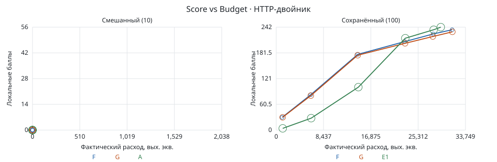

# Этап 11 · финальные эксперименты и приёмка

**Этап пока не принят.** Выполнены 80 запусков матрицы и четыре дополнительных парных запуска через управляемый HTTP-двойник, независимая проверка двух наборов, холодная сборка и Linux-проверка публичного архива. Для новой серии через прокси организаторов отсутствовал выделенный экспериментальный бюджет. Docker Desktop оставил контейнер с точной командой и ограничениями жюри в состоянии `created`. Скрытых оценок жюри в доступных материалах нет.

## Итоги локальной проверки

| Проверка | Результат | Доказательство |
| --- | --- | --- |
| Чистый снимок и холодная сборка | Основа Git `9610efa59b59a26c6fcc87af990a91a71f776669`, снимок текущего дерева с изменениями. Чистый снимок с отчётом занял 1 588 483 байта по сумме файлов и 5 784 КиБ по `du`. Холодная сборка ARM64 заняла **77,32 с**, итоговый образ **1,24 ГБ**. Контрольная сборка с отчётами и прежним Docker-контекстом заняла 1,48 с из кеша. | [Холодная сборка](logs/stage-11/run.87kAm0/build-final-v2.log), [контрольная сборка](logs/stage-11/run.87kAm0/build-submission.log), [размер](logs/stage-11/run.87kAm0/image-final.txt) |
| Закрепление зависимостей | Python 3.12.12 slim-bookworm по тегу и digest, libseccomp2 `2.5.4-1+deb12u1`, openJiuwen `0.1.16.post20`, openai `3.45.0`, httpx `0.28.1`, python-dotenv `1.2.4`. Все 159 установленных Python-дистрибутивов совпали с файлом ограничений. `pip check` прошёл. | [Dockerfile](Dockerfile), [версии](requirements-linux.txt), [аудит](logs/stage-11/run.87kAm0/public-final-audit.json) |
| Секреты | Снимок исключает `.env`, `team.json`, приватные каталоги и локальные журналы. Все 11 файлов `/app` совпали с исходниками по байтам. Известные значения локальной конфигурации отсутствовали в снимке, `/app`, конфигурации образа и 1 813 проверенных файлах, включая журналы. | [Аудит](logs/stage-11/run.87kAm0/public-final-audit.json) |
| Точная команда Docker жюри | В конфигурации Docker подтверждены writable bind `/data/tasks`, `--read-only`, tmpfs 2 ГБ, `HOME=/tmp`, отсутствие capabilities, no-new-privileges, 512 PID, 4 CPU и 16 ГБ. Аргументы агента содержали только `--tasks-dir /data/tasks`, без OUT и локального лимита. Два старта дали `created` и пустой `StartedAt` через 25 с. Фактические cgroup-лимиты и время конкурсного прогона N/A, процесс не стартовал. | [Диагностика итогового образа](logs/stage-11/run.87kAm0/jury-docker-final/diagnostics.log) |
| Сеть | В Docker принята внутренняя сеть с двойником. Итоговый Linux-образ выполнил тест через loopback при `RUN --network=none`. Фактическое ограничение исходящих соединений конкурсного контейнера адресом прокси организаторов N/A из-за сбоя запуска и отсутствия нового живого прогона. | [Docker inspect](logs/stage-11/run.87kAm0/jury-docker-final/diagnostics.log), [Linux-проверка](logs/stage-11/run.87kAm0/linux-final.log) |
| Восемь публичных примеров | **8/8, 20/20** на итоговом Linux-образе через изолированный BuildKit. Команда агента точная, без OUT, трассы и локального лимита. Время агента **1,746 с**, 22 вызова, 3 038,0 синтетического расхода по stdout. Входы совпадают с очищенным набором этапа 02. Независимая проверка подтвердила точные байты канонических файлов, изменение двух `mylib.py` и успешный запуск исходных тестов, совпавших по байтам. | [Score](logs/stage-11/run.87kAm0/public-final/score.jsonl), [stdout](logs/stage-11/run.87kAm0/linux-final/agent-stdout.jsonl) |
| Общий бюджет для двух задач | **2/2, 14/14** при лимите 6 000 в каждом из двух запусков. F израсходовал 521,1, G — 553,1, по пять вызовов. Это локальная пара из смешанного набора. | [F](logs/stage-11/run.87kAm0/pair/F/report.md), [G](logs/stage-11/run.87kAm0/pair/G/report.md) |
| Отказ и прерывание | На итоговом Linux-образе пятый запрос получил HTTP 503. Первый `DONE` и правка остались на диске, независимый тест подтвердил 1/8 задач и 2/20 балла. Учтено 633,5, удержано 2 347,9. Полный расход N/A, у запроса с 503 отсутствует usage. Тесты отдельно подтвердили сохранность при дедлайне, SIGTERM и SIGKILL. | [Частичный отчёт](logs/stage-11/run.87kAm0/outage-final/report.md), [pytest](logs/stage-11/run.87kAm0/pytest-final.log) |
| Регрессии | **96 тестов прошли** с локальным loopback. Покрыты одновременные резервы, отмена, ошибки до и после отправки, кеш и два варианта учёта reasoning. | [pytest](logs/stage-11/run.87kAm0/pytest-final.log) |

## Сверка этапов 01–10

| Этап | Флаги и контракт | Приёмка на текущем дереве |
| --- | --- | --- |
| 01 | `benchmark.py prepare/run/check/report`; baseline по умолчанию | Стадии разделены. Все 80 отчётов матрицы имеют девять обязательных файлов, включая независимый score. Восстановлен исторический baseline. Сверены все 1 193 контрольные суммы исходного снимка. |
| 02 | `--local-budget` включает общий допуск, `--trace-file` сохраняет вызовы. `--proxy-budget` только в стенде | Единый счётчик и удержания подтверждены тестами. Во всех запусках матрицы полный синтетический usage и расход в пределах лимита. Оценка резерва на новом живом прокси N/A без выделенного лимита. |
| 03 | `--mode A` | Фактические схемы, отказ недоступного действия и обычные маршруты проверены тестами. A экономит на обоих наборах двойника. В сохранённом живом пилоте потерял 2 балла. |
| 04 | `--mode B` | Длинное окно, правки, повторные чтения и тесты проверены. На архиве 96/100 против 100/100 у A на двойнике. Двойник продолжает сценарий по ID обмена, поэтому результат чувствителен к удалению старой пары. Для живого эффекта нужен новый парный замер. |
| 05 | `--mode B+C`, `--mode B+C+D`, `--generation-limit` | Проверены длинная выдача, запрос деталей, тестовая диагностика и восстановление обрезанной правки. C устранил повторение шагов B на архиве. D не сэкономил расход на архиве и увеличил его на смешанном наборе. |
| 06 | Раздельная валидация во всех режимах, `--direct-publish` отдельно | Публикация проверена по байтам и при прерывании. Флаг сохранил баллы и убрал 25 вызовов на архиве. На смешанном наборе флаг не сработал, в наборе нет coding и сценарии не дают однозначного локального результата через подходящий инструмент. |
| 07 | `--routing`, `--routing-profile`, `--cascade`, `--cascade-lambda`, `--cheap-steps` | Маршруты и эскалации проверены тестами. E3 не добавил переходов или баллов в новой матрице. Тестовый сценарий обычной ошибки инструмента не эскалировал. Отдельный сохранённый живой стресс дал 8/8 после двух переходов. |
| 08 | `--planner control/F`, `--planning-history` | Порядок, допуск, оценки, остатки и общий бюджет проверены. На смешанном наборе при 100% базового расхода минимальный резерв первого запроса 2 303,6 при лимите 2 038,3. F пропустил все десять задач. Вероятности и калибровка N/A в новой матрице, независимая история успехов не загружалась. |
| 09 | `--sessions 1..5`, `--run-timeout` | Пик пяти сессий, изоляция, общий резерв и сохранность ответов прошли в нативной среде. Фактическая работа под конкурсными cgroup-ограничениями N/A, Docker Desktop не запустил контейнер. Отдельный поток `OUT` в текущем CLI отсутствует, результаты публикуются в канонических файлах и журнале. |
| 10 | `--early-stop` поверх F | Смешанный набор содержит два проверяемых блокера из десяти. G подтвердил оба, 0 ошибочных отказов из двух. Баллы F и G совпали. На архиве G никого не отклонил и увеличил расход. |

Этап 03 проверялся в живом пилоте этапа 04. Для остальных пунктов критерии и предыдущие результаты доступны в [статусе этапов](docs/HARNESS_IMPLEMENTATION_STATUS.md). Состав артефактов и поля траекторий описаны в [схеме](docs/HARNESS_BENCHMARK_ARTIFACTS.md).

## Измеренные эффекты и следующий цикл

- **A** сохранил 39/56 на смешанном наборе при расходе 1 639,0, на 399,3 меньше baseline (−19,59%). **E1** сохранил 242/242 на архиве при 29 352,6, на 4 396,8 меньше baseline (−13,03%). В сравнении с C отдельно взятая прямая публикация дала −3 671,7 (−11,12%) и −25 вызовов (−9,09%) на архиве.
- **B** в архивном сценарии потерял четыре задачи `data_analysis`, 12 баллов и добавил 72 вызова относительно A. У всех четырёх исчерпались шаги после повторной передачи крупного результата. Стоит перепроверить удержание актуальной выдержки и отсутствие повторного чтения на живых ответах. У C архив восстановился до 242/242, а на смешанном наборе схемы и вывод увеличили расход на 353,2 (+21,55%) относительно B. D в смешанном замере дал +169,3 (+8,50%) к C при прежних баллах. Стоит выбирать схемы деталей по типу задачи и калибровать лимит D по частоте реального восстановления.
- **F** и control совпали по баллам и расходу при широком лимите. На архиве под 10–50% базового расхода F набрал 30, 83 и 178 баллов против 4, 28 и 101 у E1 в порядке каталогов. При 100% E1 набрал 242 против 236 у F. Разделите допуск первого запроса и резерв на всю задачу, измерьте калиброванный предел короткого запроса и сравните доработку на отложенных семействах.
- **G** убрал четыре вызова и 264,4 расхода (−13,32%) на смешанном наборе при 39/56. На архиве его дополнительный контекст стоил 1 760,0 (+5,26%) при тех же 242/242. При 100% архивного базового расхода G дал 231 балл против 236 у F. Следующий замер должен проверить передачу диагностической инструкции только при неоднозначных предпосылках.
- **Пять сессий** сохранили баллы, расход и число вызовов при широких лимитах. Медиана времени агента упала с 0,947 до 0,570 с на смешанном наборе (−0,377 с, −39,81%) и с 12,542 до 3,863 с на архиве (−8,679 с, −69,20%). Пик равен пяти. Это нативное измерение с HTTP-задержкой 20 мс. Суммы длительностей модели и инструментов перекрываются и приведены отдельно ниже и в отчётах. Для конкурсного выбора нужны те же сравнения с реальной задержкой, памятью и ограничениями прокси.
  В отдельном последовательном повторе после завершения тестов и сборок время агента составило 1,071 → 0,548 с (−48,83%) и 13,271 → 3,941 с (−70,30%) соответственно. Баллы и расход совпали. [Смешанный набор](logs/stage-11/run.87kAm0/isolated-pair/matrix.json) · [Архив](logs/stage-11/run.87kAm0/archive-corrected/isolated-pair/matrix.json)
- **Каскад** не добавил переходов в новой матрице. Двойник возвращает фиксированные действия. В прошлой живой проверке выигрыш наблюдался при искусственно короткой начальной попытке. Применимость к общему бюджету нужно проверить на независимых ошибках начальной модели.

## Сохранённые запуски с прокси организаторов

Эти оценки локальные. Они получены на прежних ревизиях, конфигурациях и наборах. Сравнение с текущим двойником по цене или процентам не проводится.

| Прогон | Подтверждено | Расход в выходном эквиваленте |
| --- | --- | ---: |
| Исторический baseline, 100 задач | 100/100, 242/242, 342 вызова с usage, 1 302,068 с | 50 861,7 |
| Живой пилот этапа 04, baseline / A / B | 33/33 у baseline, 31/33 у A и B | Полный расход baseline N/A, один вызов без usage |
| Живой пилот этапа 06, B+C / B+C с прямой сдачей | 20/20 и 20/20 | 4 617,1 / 4 443,2 |
| Живой пилот этапа 07, E1 / E1+E2 / E1+E2+E3 | 33/35 / 35/35 / 35/35 | 10 514,2 / 5 234,3 / 5 228,8 |
| Живой смешанный пилот этапа 10, F / G | 39/56 и 39/56 | 8 193,7 / 3 285,5 |

[Импорт исторического baseline](logs/stage-11/run.87kAm0/historical/report.md) · [Сохранённый живой пилот F/G](logs/stage-10/run.LFw7WG/organizer/comparison.md)

Ретроспективная верхняя граница по **реальному сохранённому baseline** при долях от 50 861,7:

| Доля | 10% | 25% | 50% | 75% | 90% | 100% |
| --- | ---: | ---: | ---: | ---: | ---: | ---: |
| Лимит | 5 086,1 | 12 715,4 | 25 430,8 | 38 146,2 | 45 775,5 | 50 861,7 |
| Подтверждённые баллы по рюкзаку 0/1 | 76 | 146 | 190 | 223 | 238 | 242 |

Эта граница применима к офлайн-выбору среди ста фиксированных успешных траекторий исторического baseline и их полных цен. Бюджеты округлены вниз до десятой. Свежая кривая через прокси организаторов **N/A**, поскольку на серию не выделен экспериментальный бюджет.

## Официальные результаты

Квалификация и финальные скрытые тесты **N/A**. Официальной оценки или подтверждения допуска жюри для проверяемого дерева нет.

## Подготовка к внешней сдаче

1. На исправном Docker-хосте запустить точную команду жюри, проверить фактические ограничения, сетевой маршрут до прокси и время.
2. Получить лимит новой серии, провести живые повторы и бюджетные прогоны. Выбрать конфигурацию при одном лимите по баллам, затем по расходу.
3. Проверить финальный коммит и чистую сборку, выполнить проверку безопасности и обе отборочные задачи.
4. По отдельному поручению разместить репозиторий на GitHub или GitFlic. Для приватного репозитория выдать доступ `promsoft` и `madrugado` до закрытия. Жюри оценивает последний коммит к этому моменту.

## Подробная локальная матрица

Первый технический прогон архивного двойника выявил совпадающие инструкции у coding-задач. Фикстуры стали различаться по началу фактически прочитанного исходника. В матрицу включён повтор всей серии на исправленных фикстурах.

Все замеры в этом файле выполнены на macOS ARM64, Python 3.12, openJiuwen 0.1.16.post20, через управляемый HTTP-двойник. Двойник возвращает заранее подготовленные действия. Usage синтетический и зависит от фактически переданных сообщений, схем и ответа. Задержка HTTP 20 мс. Время параллельных вызовов суммируется по событиям и перекрывается. Полное время запуска измерено по часам стенда.

## Смешанный (10)

Лимит 11,000.0, модель `qwen3.8-27b-noreason`, SHA-256 очищенных входов `01d40dac490c20d83e6daef9a342249bfc00cc6bdf079ce55b3f4320a41b34fc`. Флаги, версии и SHA-256 кода записаны в манифестах отдельных запусков. A–D используют стандартную сдачу. E1 и E2 сравниваются с C по одному флагу, E3 добавляет каскад к E2. F сравнивается с control при E3, G и F-5 меняют один параметр F.

| Режим | Локальные баллы | Решено | Расход | Δ расхода к baseline | Δ баллов к baseline | LLM | Вход | Выход | Сокращение входа | Время, с |
| --- | ---: | ---: | ---: | --- | --- | ---: | ---: | ---: | ---: | ---: |
| [baseline](logs/stage-11/run.87kAm0/mixed-ablation/baseline/report.md) | 39 | 8 | 2,038.3 | +0.000 (+0.00%) | +0.000 (+0.00%) | 20 | 12343 | 804 | +0.00% | 1.048 |
| [A](logs/stage-11/run.87kAm0/mixed-ablation/A/report.md) | 39 | 8 | 1,639 | -399.300 (-19.59%) | +0.000 (+0.00%) | 20 | 8350 | 804 | +32.35% | 0.933 |
| [B](logs/stage-11/run.87kAm0/mixed-ablation/B/report.md) | 39 | 8 | 1,639 | -399.300 (-19.59%) | +0.000 (+0.00%) | 20 | 8350 | 804 | +32.35% | 0.937 |
| [C](logs/stage-11/run.87kAm0/mixed-ablation/C/report.md) | 39 | 8 | 1,992.2 | -46.100 (-2.26%) | +0.000 (+0.00%) | 20 | 11882 | 804 | +3.73% | 0.935 |
| [D](logs/stage-11/run.87kAm0/mixed-ablation/D/report.md) | 39 | 8 | 2,161.5 | +123.200 (+6.04%) | +0.000 (+0.00%) | 22 | 13275 | 834 | -7.55% | 1.033 |
| [E1](logs/stage-11/run.87kAm0/mixed-ablation/E1/report.md) | 39 | 8 | 1,992.2 | -46.100 (-2.26%) | +0.000 (+0.00%) | 20 | 11882 | 804 | +3.73% | 0.937 |
| [E2](logs/stage-11/run.87kAm0/mixed-ablation/E2/report.md) | 39 | 8 | 1,984.9 | -53.400 (-2.62%) | +0.000 (+0.00%) | 20 | 11809 | 804 | +4.33% | 0.968 |
| [E3](logs/stage-11/run.87kAm0/mixed-ablation/E3/report.md) | 39 | 8 | 1,984.9 | -53.400 (-2.62%) | +0.000 (+0.00%) | 20 | 11809 | 804 | +4.33% | 0.946 |
| [control](logs/stage-11/run.87kAm0/mixed-ablation/control/report.md) | 39 | 8 | 1,984.9 | -53.400 (-2.62%) | +0.000 (+0.00%) | 20 | 11809 | 804 | +4.33% | 0.936 |
| [F](logs/stage-11/run.87kAm0/mixed-ablation/F/report.md) | 39 | 8 | 1,984.9 | -53.400 (-2.62%) | +0.000 (+0.00%) | 20 | 11809 | 804 | +4.33% | 0.946 |
| [G](logs/stage-11/run.87kAm0/mixed-ablation/G/report.md) | 39 | 8 | 1,720.5 | -317.800 (-15.59%) | +0.000 (+0.00%) | 16 | 10345 | 686 | +16.19% | 0.823 |
| [F-5](logs/stage-11/run.87kAm0/mixed-ablation/F-5/report.md) | 39 | 8 | 1,984.9 | -53.400 (-2.62%) | +0.000 (+0.00%) | 20 | 11809 | 804 | +4.33% | 0.56 |

Локальный кандидат при этом лимите — **A** с 39 баллами за 1,639 выходных эквивалентов. Полное равенство у A, B. Выбран режим с меньшим числом включённых механизмов.

| Сравнение | Δ баллов | Δ расхода | Δ вызовов | Δ времени |
| --- | --- | --- | --- | --- |
| A / baseline | +0.000 (+0.00%) | -399.300 (-19.59%) | +0.000 (+0.00%) | -0.115 (-10.97%) |
| B / A | +0.000 (+0.00%) | +0.000 (+0.00%) | +0.000 (+0.00%) | +0.004 (+0.43%) |
| C / B | +0.000 (+0.00%) | +353.200 (+21.55%) | +0.000 (+0.00%) | -0.002 (-0.21%) |
| D / C | +0.000 (+0.00%) | +169.300 (+8.50%) | +2.000 (+10.00%) | +0.098 (+10.48%) |
| E1 / C | +0.000 (+0.00%) | +0.000 (+0.00%) | +0.000 (+0.00%) | +0.002 (+0.21%) |
| E2 / C | +0.000 (+0.00%) | -7.300 (-0.37%) | +0.000 (+0.00%) | +0.033 (+3.53%) |
| E3 / E2 | +0.000 (+0.00%) | +0.000 (+0.00%) | +0.000 (+0.00%) | -0.022 (-2.27%) |
| F / control | +0.000 (+0.00%) | +0.000 (+0.00%) | +0.000 (+0.00%) | +0.010 (+1.07%) |
| G / F | +0.000 (+0.00%) | -264.400 (-13.32%) | -4.000 (-20.00%) | -0.123 (-13.00%) |
| F-5 / F | +0.000 (+0.00%) | +0.000 (+0.00%) | +0.000 (+0.00%) | -0.386 (-40.80%) |

| Повторы | n | Баллы среднее / медиана / min–max | Расход среднее / медиана / min–max | Время агента среднее / медиана / min–max, с |
| --- | ---: | --- | --- | --- |
| baseline | 3 | 39 / 39 / 39–39 | 2,038.3 / 2,038.3 / 2,038.3–2,038.3 | 0.974 / 0.942 / 0.931–1.048 |
| F | 3 | 39 / 39 / 39–39 | 1,984.9 / 1,984.9 / 1,984.9–1,984.9 | 0.949 / 0.947 / 0.946–0.955 |
| F-5 | 3 | 39 / 39 / 39–39 | 1,984.9 / 1,984.9 / 1,984.9–1,984.9 | 0.593 / 0.57 / 0.56–0.648 |
| G | 3 | 39 / 39 / 39–39 | 1,720.5 / 1,720.5 / 1,720.5–1,720.5 | 0.857 / 0.823 / 0.812–0.936 |
| A | 3 | 39 / 39 / 39–39 | 1,639 / 1,639 / 1,639–1,639 | 0.947 / 0.951 / 0.933–0.958 |

### Сравнение кандидата с baseline

| Метрика | Baseline | Кандидат | Δ |
| --- | ---: | ---: | --- |
| Баллы | 39 | 39 | +0.000 (+0.00%) |
| Решено | 8 | 8 | +0.000 (+0.00%) |
| Доля успеха | 0.8 | 0.8 | +0.000 (+0.00%) |
| Расход | 2,038.3 | 1,639 | -399.300 (-19.59%) |
| Вход | 12343 | 8350 | -3,993.000 (-32.35%) |
| Выход | 804 | 804 | +0.000 (+0.00%) |
| Кеш | 0 | 0 | +0.000 (база 0, процент неприменим) |
| Reasoning | 0 | 0 | +0.000 (база 0, процент неприменим) |
| Вызовы LLM | 20 | 20 | +0.000 (+0.00%) |
| Время агента, с | 1.048 | 0.933 | -0.115 (-10.97%) |
| Расход на балл | 52.264 | 42.026 | -10.238 (-19.59%) |
| Баллы на 1 000 экв. | 19.134 | 23.795 | +4.661 (+24.36%) |
| Ошибки инструментов | 1 | 1 | +0.000 (+0.00%) |
| Эскалации | 0 | 0 | +0.000 (база 0, процент неприменим) |

### Бюджетные прогоны

| Режим | Лимит | Баллы | Решено | Фактический расход | Факт / лимит | Остаток после удержаний | Порядок |
| --- | ---: | ---: | ---: | ---: | ---: | ---: | --- |
| [F-10](logs/stage-11/run.87kAm0/mixed-curve/F-10/report.md) | 203.8 | 0 | 0 | 0 | 0.0% | 203.8 | [0 задач](logs/stage-11/run.87kAm0/mixed-curve/F-10/metrics.json) |
| [G-10](logs/stage-11/run.87kAm0/mixed-curve/G-10/report.md) | 203.8 | 0 | 0 | 0 | 0.0% | 203.8 | [0 задач](logs/stage-11/run.87kAm0/mixed-curve/G-10/metrics.json) |
| [F-25](logs/stage-11/run.87kAm0/mixed-curve/F-25/report.md) | 509.5 | 0 | 0 | 0 | 0.0% | 509.5 | [0 задач](logs/stage-11/run.87kAm0/mixed-curve/F-25/metrics.json) |
| [G-25](logs/stage-11/run.87kAm0/mixed-curve/G-25/report.md) | 509.5 | 0 | 0 | 0 | 0.0% | 509.5 | [0 задач](logs/stage-11/run.87kAm0/mixed-curve/G-25/metrics.json) |
| [F-50](logs/stage-11/run.87kAm0/mixed-curve/F-50/report.md) | 1,019.1 | 0 | 0 | 0 | 0.0% | 1,019.1 | [0 задач](logs/stage-11/run.87kAm0/mixed-curve/F-50/metrics.json) |
| [G-50](logs/stage-11/run.87kAm0/mixed-curve/G-50/report.md) | 1,019.1 | 0 | 0 | 0 | 0.0% | 1,019.1 | [0 задач](logs/stage-11/run.87kAm0/mixed-curve/G-50/metrics.json) |
| [F-75](logs/stage-11/run.87kAm0/mixed-curve/F-75/report.md) | 1,528.7 | 0 | 0 | 0 | 0.0% | 1,528.7 | [0 задач](logs/stage-11/run.87kAm0/mixed-curve/F-75/metrics.json) |
| [G-75](logs/stage-11/run.87kAm0/mixed-curve/G-75/report.md) | 1,528.7 | 0 | 0 | 0 | 0.0% | 1,528.7 | [0 задач](logs/stage-11/run.87kAm0/mixed-curve/G-75/metrics.json) |
| [F-90](logs/stage-11/run.87kAm0/mixed-curve/F-90/report.md) | 1,834.4 | 0 | 0 | 0 | 0.0% | 1,834.4 | [0 задач](logs/stage-11/run.87kAm0/mixed-curve/F-90/metrics.json) |
| [G-90](logs/stage-11/run.87kAm0/mixed-curve/G-90/report.md) | 1,834.4 | 0 | 0 | 0 | 0.0% | 1,834.4 | [0 задач](logs/stage-11/run.87kAm0/mixed-curve/G-90/metrics.json) |
| [F-100](logs/stage-11/run.87kAm0/mixed-curve/F-100/report.md) | 2,038.3 | 0 | 0 | 0 | 0.0% | 2,038.3 | [0 задач](logs/stage-11/run.87kAm0/mixed-curve/F-100/metrics.json) |
| [G-100](logs/stage-11/run.87kAm0/mixed-curve/G-100/report.md) | 2,038.3 | 0 | 0 | 0 | 0.0% | 2,038.3 | [0 задач](logs/stage-11/run.87kAm0/mixed-curve/G-100/metrics.json) |
| [A-10](logs/stage-11/run.87kAm0/mixed-A-curve/A-10/report.md) | 203.8 | 0 | 0 | 0 | 0.0% | 203.8 | [10 задач](logs/stage-11/run.87kAm0/mixed-A-curve/A-10/metrics.json) |
| [A-25](logs/stage-11/run.87kAm0/mixed-A-curve/A-25/report.md) | 509.5 | 0 | 0 | 0 | 0.0% | 509.5 | [10 задач](logs/stage-11/run.87kAm0/mixed-A-curve/A-25/metrics.json) |
| [A-50](logs/stage-11/run.87kAm0/mixed-A-curve/A-50/report.md) | 1,019.1 | 0 | 0 | 0 | 0.0% | 1,019.1 | [10 задач](logs/stage-11/run.87kAm0/mixed-A-curve/A-50/metrics.json) |
| [A-75](logs/stage-11/run.87kAm0/mixed-A-curve/A-75/report.md) | 1,528.7 | 0 | 0 | 0 | 0.0% | 1,528.7 | [10 задач](logs/stage-11/run.87kAm0/mixed-A-curve/A-75/metrics.json) |
| [A-90](logs/stage-11/run.87kAm0/mixed-A-curve/A-90/report.md) | 1,834.4 | 0 | 0 | 0 | 0.0% | 1,834.4 | [10 задач](logs/stage-11/run.87kAm0/mixed-A-curve/A-90/metrics.json) |
| [A-100](logs/stage-11/run.87kAm0/mixed-A-curve/A-100/report.md) | 2,038.3 | 0 | 0 | 0 | 0.0% | 2,038.3 | [10 задач](logs/stage-11/run.87kAm0/mixed-A-curve/A-100/metrics.json) |

### Ретроспективная верхняя граница

| Источник измеренных цен | n | 10% | 25% | 50% | 75% | 90% | 100% |
| --- | ---: | ---: | ---: | ---: | ---: | ---: | ---: |
| baseline | 8 | 11 | 18 | 29 | 36 | 39 | 39 |
| F | 8 | 11 | 18 | 29 | 36 | 39 | 39 |
| G | 8 | 11 | 18 | 29 | 36 | 39 | 39 |
| A | 8 | 11 | 22 | 33 | 39 | 39 | 39 |

Точное решение задачи о рюкзаке 0/1 по подтверждённым ответам данного набора и одного опорного прогона указанного режима. Цена равна полному известному расходу задачи. Задачи без подтверждения и без полной цены исключены. Граница относится к выбору среди этих ответов при фиксированных ценах. Онлайн-резервы, стоимость неудачных попыток, время, другие траектории и скрытые тесты в эту модель не входят.

### [baseline](logs/stage-11/run.87kAm0/mixed-ablation/baseline/report.md)

| Тип | Баллы | Вызовы | Расход | Средний расход | Среднее / медиана / P90, с |
| --- | ---: | ---: | ---: | ---: | --- |
| data_analysis | 11 | 7 | 714.3 | 238.1 | 0.077 / 0.065 / 0.104 |
| math | 11 | 2 | 201.3 | 100.65 | 0.224 / 0.224 / 0.41 |
| search | 17 | 11 | 1,122.7 | 224.54 | 0.074 / 0.067 / 0.102 |

- Учёт usage 20/20. Вход/выход 12343/804, кеш/reasoning 0/0. Расход на успешную задачу 209.675. Среднее / медиана / P90 на начатую задачу 203.83 / 206.65 / 321.6.
- Контекст первых вызовов сумма/среднее 5733/573.3. Повторных 6610/661. Доля повторного входа 53.6%, изменение окна между вызовами 74.6 токена в среднем. Повторная передача в байтах {'messages': 6721, 'tool_messages': 262, 'tool_schemas': 15380}. Байты ответа LLM по полезным полям: текст 54, reasoning 0, аргументы инструментов 374. Вызовов на начатую задачу 2.
- Суммы времени LLM и инструментов 662.951 и 21.244 мс. Медиана / P95 / максимум одного вызова LLM 31.157 / 33.086 / 73.189 мс. Время запуска 2.823 с, сессий 1, пик 1.
- Бюджет использован на 18.5% по занятости. Остаток 8,961.7, превышение 0.0.
- Маршруты {'BASELINE': {'tasks': 10, 'correct': 8, 'score': 39}}. Вызовы по моделям {'qwen3.8-27b-noreason': 20}. Доли локальных и решений начальной моделью 0 и 1. Переходы 0, частота 0, успешность N/A (переходов не было).
- Расход до и после эскалаций N/A (переходов не было). Переходов без прироста 0.
- Прогноз и калибровка N/A (режим без планировщика).
- Итоги раннего отказа N/A (проверка G выключена).

| Инструмент | Вызовы | Успех | Ошибки / доля | Недопустимые / доля | Повторы | Среднее, мс | Всего байт |
| --- | ---: | ---: | --- | --- | ---: | ---: | ---: |
| read_file | 10 | 9 | 1 / 0.1 | 0 / 0.0% | 0 | 0.975 | 542 |
| submit_answer | 8 | 8 | 0 / 0 | 0 / 0.0% | 0 | 1.437 | 104 |

- Расход. `rolling-margin` (326.7), `relay-owner` (321.6), `depot-route` (207.3).
- Число вызовов. `rolling-margin` (3), `relay-owner` (3), `vault-close` (2).
- Повторный вход, токены. `rolling-margin` (1392), `relay-owner` (1353), `depot-route` (661).
- Повторные результаты инструментов, байты. `relay-owner` (135), `rolling-margin` (127), `vault-close` (0).
- Причины ошибок и недопустимых вызовов. {'read_file / error / ValueError': 1}.
- Отказы по отсутствующей в запросе схеме. {}.

### [F](logs/stage-11/run.87kAm0/mixed-ablation/F/report.md)

| Тип | Баллы | Вызовы | Расход | Средний расход | Среднее / медиана / P90, с |
| --- | ---: | ---: | ---: | ---: | --- |
| data_analysis | 11 | 7 | 724.4 | 241.467 | 0.074 / 0.067 / 0.092 |
| math | 11 | 2 | 162.1 | 81.05 | 0.034 / 0.034 / 0.034 |
| search | 17 | 11 | 1,098.4 | 219.68 | 0.13 / 0.066 / 0.364 |

- Учёт usage 20/20. Вход/выход 11809/804, кеш/reasoning 0/0. Расход на успешную задачу 202.262. Среднее / медиана / P90 на начатую задачу 198.49 / 190.05 / 325.9.
- Контекст первых вызовов сумма/среднее 5255/525.5. Повторных 6554/655.4. Доля повторного входа 55.5%, изменение окна между вызовами 74.7 токена в среднем. Повторная передача в байтах {'messages': 6637, 'tool_messages': 262, 'tool_schemas': 15238}. Байты ответа LLM по полезным полям: текст 54, reasoning 0, аргументы инструментов 374. Вызовов на начатую задачу 2.
- Суммы времени LLM и инструментов 624.856 и 20.637 мс. Медиана / P95 / максимум одного вызова LLM 30.005 / 31.384 / 63.468 мс. Время запуска 2.203 с, сессий 1, пик 1.
- Бюджет использован на 18.0% по занятости. Остаток 9,015.1, превышение 0.0.
- Маршруты {'CASCADE': {'tasks': 5, 'correct': 4, 'score': 22}, 'CHEAP_LLM': {'tasks': 5, 'correct': 4, 'score': 17}}. Вызовы по моделям {'qwen3.8-27b-noreason': 20}. Доли локальных и решений начальной моделью 0 и 1. Переходы 0, частота 0, успешность N/A (переходов не было).
- Расход до и после эскалаций N/A (переходов не было). Переходов без прироста 0.
- План F. Пропуски {}, ошибки допуска 0, расход выше прогноза у 0 задач. MAE/MAPE завершённых 1,362.04/871.724% (n=10). Калибровка N/A (нет независимых оценок P).
- Итоги выполнимости {'DONE': 8, 'UNCERTAIN': 2}, причины {'answer_published': 8, 'model_no_submission': 2}. Время распознавания 0 мс, измерено до отказов 0.0. Доля ложных отказов N/A (нет отказов).

| Инструмент | Вызовы | Успех | Ошибки / доля | Недопустимые / доля | Повторы | Среднее, мс | Всего байт |
| --- | ---: | ---: | --- | --- | ---: | ---: | ---: |
| read_file | 10 | 9 | 1 / 0.1 | 0 / 0.0% | 0 | 1.03 | 542 |
| submit_answer | 8 | 8 | 0 / 0 | 0 / 0.0% | 0 | 1.292 | 104 |

- Расход. `rolling-margin` (331), `relay-owner` (325.9), `daily-peak` (209.7).
- Число вызовов. `rolling-margin` (3), `relay-owner` (3), `vault-close` (2).
- Повторный вход, токены. `rolling-margin` (1420), `relay-owner` (1382), `daily-peak` (667).
- Повторные результаты инструментов, байты. `relay-owner` (135), `rolling-margin` (127), `vault-close` (0).
- Причины ошибок и недопустимых вызовов. {'read_file / error / ValueError': 1}.
- Отказы по отсутствующей в запросе схеме. {}.

### [G](logs/stage-11/run.87kAm0/mixed-ablation/G/report.md)

| Тип | Баллы | Вызовы | Расход | Средний расход | Среднее / медиана / P90, с |
| --- | ---: | ---: | ---: | ---: | --- |
| data_analysis | 11 | 5 | 572.7 | 286.35 | 0.085 / 0.085 / 0.1 |
| math | 11 | 2 | 174.9 | 87.45 | 0.033 / 0.033 / 0.035 |
| search | 17 | 9 | 972.9 | 243.225 | 0.146 / 0.082 / 0.357 |

- Учёт usage 16/16. Вход/выход 10345/686, кеш/reasoning 0/0. Расход на успешную задачу 215.062. Среднее / медиана / P90 на начатую задачу 215.062 / 212.5 / 350.2.
- Контекст первых вызовов сумма/среднее 4596/574.5. Повторных 5749/718.625. Доля повторного входа 55.6%, изменение окна между вызовами 75.125 токена в среднем. Повторная передача в байтах {'messages': 7417, 'tool_messages': 262, 'tool_schemas': 12092}. Байты ответа LLM по полезным полям: текст 0, reasoning 0, аргументы инструментов 324. Вызовов на начатую задачу 2.
- Суммы времени LLM и инструментов 511.835 и 20.419 мс. Медиана / P95 / максимум одного вызова LLM 30.735 / 65.197 / 65.197 мс. Время запуска 2.092 с, сессий 1, пик 1.
- Бюджет использован на 15.6% по занятости. Остаток 9,279.5, превышение 0.0.
- Маршруты {'CASCADE': {'tasks': 4, 'correct': 4, 'score': 22}, 'CHEAP_LLM': {'tasks': 4, 'correct': 4, 'score': 17}}. Вызовы по моделям {'qwen3.8-27b-noreason': 16}. Доли локальных и решений начальной моделью 0 и 1. Переходы 0, частота 0, успешность N/A (переходов не было).
- Расход до и после эскалаций N/A (переходов не было). Переходов без прироста 0.
- План F. Пропуски {'required_resource_wrong_type': 1, 'required_input_absent': 1}, ошибки допуска 0, расход выше прогноза у 0 задач. MAE/MAPE завершённых 1,361.713/848.74% (n=8). Калибровка N/A (нет независимых оценок P).
- Итоги выполнимости {'DONE': 8, 'UNSOLVABLE_CONFIRMED': 2}, причины {'answer_published': 8, 'required_resource_wrong_type': 1, 'required_input_absent': 1}. Время распознавания 0.093 мс, измерено до отказов 0.0. Доля ложных отказов 0.0%.

| Инструмент | Вызовы | Успех | Ошибки / доля | Недопустимые / доля | Повторы | Среднее, мс | Всего байт |
| --- | ---: | ---: | --- | --- | ---: | ---: | ---: |
| read_file | 8 | 8 | 0 / 0 | 0 / 0.0% | 0 | 1.158 | 492 |
| submit_answer | 8 | 8 | 0 / 0 | 0 / 0.0% | 0 | 1.395 | 104 |

- Расход. `rolling-margin` (350.2), `relay-owner` (345.1), `daily-peak` (222.5).
- Число вызовов. `rolling-margin` (3), `relay-owner` (3), `spectrum-audit` (2).
- Повторный вход, токены. `rolling-margin` (1548), `relay-owner` (1510), `daily-peak` (731).
- Повторные результаты инструментов, байты. `relay-owner` (135), `rolling-margin` (127), `spectrum-audit` (0).
- Причины ошибок и недопустимых вызовов. {}.
- Отказы по отсутствующей в запросе схеме. {}.

### [A](logs/stage-11/run.87kAm0/mixed-ablation/A/report.md)

| Тип | Баллы | Вызовы | Расход | Средний расход | Среднее / медиана / P90, с |
| --- | ---: | ---: | ---: | ---: | --- |
| data_analysis | 11 | 7 | 583.7 | 194.567 | 0.074 / 0.064 / 0.095 |
| math | 11 | 2 | 137.5 | 68.75 | 0.19 / 0.19 / 0.348 |
| search | 17 | 11 | 917.8 | 183.56 | 0.066 / 0.062 / 0.085 |

- Учёт usage 20/20. Вход/выход 8350/804, кеш/reasoning 0/0. Расход на успешную задачу 169.075. Среднее / медиана / P90 на начатую задачу 163.9 / 169.35 / 265.7.
- Контекст первых вызовов сумма/среднее 3603/360.3. Повторных 4747/474.7. Доля повторного входа 56.9%, изменение окна между вызовами 74.8 токена в среднем. Повторная передача в байтах {'messages': 5401, 'tool_messages': 262, 'tool_schemas': 9670}. Байты ответа LLM по полезным полям: текст 54, reasoning 0, аргументы инструментов 374. Вызовов на начатую задачу 2.
- Суммы времени LLM и инструментов 615.93 и 17.027 мс. Медиана / P95 / максимум одного вызова LLM 29.47 / 31.424 / 69.322 мс. Время запуска 2.252 с, сессий 1, пик 1.
- Бюджет использован на 14.9% по занятости. Остаток 9,361.0, превышение 0.0.
- Маршруты {'BASELINE': {'tasks': 10, 'correct': 8, 'score': 39}}. Вызовы по моделям {'qwen3.8-27b-noreason': 20}. Доли локальных и решений начальной моделью 0 и 1. Переходы 0, частота 0, успешность N/A (переходов не было).
- Расход до и после эскалаций N/A (переходов не было). Переходов без прироста 0.
- Прогноз и калибровка N/A (режим без планировщика).
- Итоги раннего отказа N/A (проверка G выключена).

| Инструмент | Вызовы | Успех | Ошибки / доля | Недопустимые / доля | Повторы | Среднее, мс | Всего байт |
| --- | ---: | ---: | --- | --- | ---: | ---: | ---: |
| read_file | 10 | 9 | 1 / 0.1 | 0 / 0.0% | 0 | 0.827 | 542 |
| submit_answer | 8 | 8 | 0 / 0 | 0 / 0.0% | 0 | 1.095 | 104 |

- Расход. `rolling-margin` (270.7), `relay-owner` (265.7), `depot-route` (170.1).
- Число вызовов. `rolling-margin` (3), `relay-owner` (3), `vault-close` (2).
- Повторный вход, токены. `rolling-margin` (1018), `relay-owner` (980), `depot-route` (475).
- Повторные результаты инструментов, байты. `relay-owner` (135), `rolling-margin` (127), `vault-close` (0).
- Причины ошибок и недопустимых вызовов. {'read_file / error / ValueError': 1}.
- Отказы по отсутствующей в запросе схеме. {}.

Комплект этапа 01 присутствует у всех 40 прогонов. SHA-256 входов совпадает.

## Сохранённый (100)

Лимит 50,861.7, модель `qwen3.8-27b-noreason`, SHA-256 очищенных входов `bae62b0a9b0b58a3a961ed6ba17ac3fdbe961f676d9776cec2ce1825554c316f`. Флаги, версии и SHA-256 кода записаны в манифестах отдельных запусков. A–D используют стандартную сдачу. E1 и E2 сравниваются с C по одному флагу, E3 добавляет каскад к E2. F сравнивается с control при E3, G и F-5 меняют один параметр F.

| Режим | Локальные баллы | Решено | Расход | Δ расхода к baseline | Δ баллов к baseline | LLM | Вход | Выход | Сокращение входа | Время, с |
| --- | ---: | ---: | ---: | --- | --- | ---: | ---: | ---: | ---: | ---: |
| [baseline](logs/stage-11/run.87kAm0/archive-corrected/archive-ablation/baseline/report.md) | 242 | 100 | 33,749.4 | +0.000 (+0.00%) | +0.000 (+0.00%) | 275 | 209194 | 12830 | +0.00% | 12.326 |
| [A](logs/stage-11/run.87kAm0/archive-corrected/archive-ablation/A/report.md) | 242 | 100 | 29,718.4 | -4,031.000 (-11.94%) | +0.000 (+0.00%) | 275 | 168884 | 12830 | +19.27% | 12.456 |
| [B](logs/stage-11/run.87kAm0/archive-corrected/archive-ablation/B/report.md) | 230 | 96 | 36,761.4 | +3,012.000 (+8.92%) | -12.000 (-4.96%) | 347 | 208354 | 15926 | +0.40% | 14.581 |
| [C](logs/stage-11/run.87kAm0/archive-corrected/archive-ablation/C/report.md) | 242 | 100 | 33,024.3 | -725.100 (-2.15%) | +0.000 (+0.00%) | 275 | 201943 | 12830 | +3.47% | 12.372 |
| [D](logs/stage-11/run.87kAm0/archive-corrected/archive-ablation/D/report.md) | 242 | 100 | 33,024.3 | -725.100 (-2.15%) | +0.000 (+0.00%) | 275 | 201943 | 12830 | +3.47% | 12.528 |
| [E1](logs/stage-11/run.87kAm0/archive-corrected/archive-ablation/E1/report.md) | 242 | 100 | 29,352.6 | -4,396.800 (-13.03%) | +0.000 (+0.00%) | 250 | 175976 | 11755 | +15.88% | 11.648 |
| [E2](logs/stage-11/run.87kAm0/archive-corrected/archive-ablation/E2/report.md) | 242 | 100 | 33,478.1 | -271.300 (-0.80%) | +0.000 (+0.00%) | 275 | 206481 | 12830 | +1.30% | 12.573 |
| [E3](logs/stage-11/run.87kAm0/archive-corrected/archive-ablation/E3/report.md) | 242 | 100 | 33,478.1 | -271.300 (-0.80%) | +0.000 (+0.00%) | 275 | 206481 | 12830 | +1.30% | 12.415 |
| [control](logs/stage-11/run.87kAm0/archive-corrected/archive-ablation/control/report.md) | 242 | 100 | 33,478.1 | -271.300 (-0.80%) | +0.000 (+0.00%) | 275 | 206481 | 12830 | +1.30% | 12.584 |
| [F](logs/stage-11/run.87kAm0/archive-corrected/archive-ablation/F/report.md) | 242 | 100 | 33,478.1 | -271.300 (-0.80%) | +0.000 (+0.00%) | 275 | 206481 | 12830 | +1.30% | 12.542 |
| [G](logs/stage-11/run.87kAm0/archive-corrected/archive-ablation/G/report.md) | 242 | 100 | 35,238.1 | +1,488.700 (+4.41%) | +0.000 (+0.00%) | 275 | 224081 | 12830 | -7.12% | 12.475 |
| [F-5](logs/stage-11/run.87kAm0/archive-corrected/archive-ablation/F-5/report.md) | 242 | 100 | 33,478.1 | -271.300 (-0.80%) | +0.000 (+0.00%) | 275 | 206481 | 12830 | +1.30% | 4.09 |

Локальный кандидат при этом лимите — **E1** с 242 баллами за 29,352.6 выходных эквивалентов.

| Сравнение | Δ баллов | Δ расхода | Δ вызовов | Δ времени |
| --- | --- | --- | --- | --- |
| A / baseline | +0.000 (+0.00%) | -4,031.000 (-11.94%) | +0.000 (+0.00%) | +0.130 (+1.05%) |
| B / A | -12.000 (-4.96%) | +7,043.000 (+23.70%) | +72.000 (+26.18%) | +2.125 (+17.06%) |
| C / B | +12.000 (+5.22%) | -3,737.100 (-10.17%) | -72.000 (-20.75%) | -2.209 (-15.15%) |
| D / C | +0.000 (+0.00%) | +0.000 (+0.00%) | +0.000 (+0.00%) | +0.156 (+1.26%) |
| E1 / C | +0.000 (+0.00%) | -3,671.700 (-11.12%) | -25.000 (-9.09%) | -0.724 (-5.85%) |
| E2 / C | +0.000 (+0.00%) | +453.800 (+1.37%) | +0.000 (+0.00%) | +0.201 (+1.62%) |
| E3 / E2 | +0.000 (+0.00%) | +0.000 (+0.00%) | +0.000 (+0.00%) | -0.158 (-1.26%) |
| F / control | +0.000 (+0.00%) | +0.000 (+0.00%) | +0.000 (+0.00%) | -0.042 (-0.33%) |
| G / F | +0.000 (+0.00%) | +1,760.000 (+5.26%) | +0.000 (+0.00%) | -0.067 (-0.53%) |
| F-5 / F | +0.000 (+0.00%) | +0.000 (+0.00%) | +0.000 (+0.00%) | -8.452 (-67.39%) |

| Повторы | n | Баллы среднее / медиана / min–max | Расход среднее / медиана / min–max | Время агента среднее / медиана / min–max, с |
| --- | ---: | --- | --- | --- |
| baseline | 3 | 242 / 242 / 242–242 | 33,749.4 / 33,749.4 / 33,749.4–33,749.4 | 12.645 / 12.502 / 12.326–13.107 |
| F | 3 | 242 / 242 / 242–242 | 33,478.1 / 33,478.1 / 33,478.1–33,478.1 | 12.472 / 12.542 / 12.271–12.603 |
| F-5 | 3 | 242 / 242 / 242–242 | 33,478.1 / 33,478.1 / 33,478.1–33,478.1 | 3.921 / 3.863 / 3.81–4.09 |
| G | 3 | 242 / 242 / 242–242 | 35,238.1 / 35,238.1 / 35,238.1–35,238.1 | 12.329 / 12.297 / 12.215–12.475 |
| E1 | 3 | 242 / 242 / 242–242 | 29,352.6 / 29,352.6 / 29,352.6–29,352.6 | 11.726 / 11.648 / 11.596–11.934 |

### Сравнение кандидата с baseline

| Метрика | Baseline | Кандидат | Δ |
| --- | ---: | ---: | --- |
| Баллы | 242 | 242 | +0.000 (+0.00%) |
| Решено | 100 | 100 | +0.000 (+0.00%) |
| Доля успеха | 1 | 1 | +0.000 (+0.00%) |
| Расход | 33,749.4 | 29,352.6 | -4,396.800 (-13.03%) |
| Вход | 209194 | 175976 | -33,218.000 (-15.88%) |
| Выход | 12830 | 11755 | -1,075.000 (-8.38%) |
| Кеш | 0 | 0 | +0.000 (база 0, процент неприменим) |
| Reasoning | 0 | 0 | +0.000 (база 0, процент неприменим) |
| Вызовы LLM | 275 | 250 | -25.000 (-9.09%) |
| Время агента, с | 12.326 | 11.648 | -0.678 (-5.50%) |
| Расход на балл | 139.46 | 121.292 | -18.169 (-13.03%) |
| Баллы на 1 000 экв. | 7.17 | 8.245 | +1.074 (+14.98%) |
| Ошибки инструментов | 0 | 0 | +0.000 (база 0, процент неприменим) |
| Эскалации | 0 | 0 | +0.000 (база 0, процент неприменим) |

### Бюджетные прогоны

| Режим | Лимит | Баллы | Решено | Фактический расход | Факт / лимит | Остаток после удержаний | Порядок |
| --- | ---: | ---: | ---: | ---: | ---: | ---: | --- |
| [F-10](logs/stage-11/run.87kAm0/archive-corrected/archive-curve/F-10/report.md) | 3,374.9 | 30 | 6 | 1,065.6 | 31.6% | 2,309.3 | [6 задач](logs/stage-11/run.87kAm0/archive-corrected/archive-curve/F-10/metrics.json) |
| [G-10](logs/stage-11/run.87kAm0/archive-corrected/archive-curve/G-10/report.md) | 3,374.9 | 30 | 6 | 1,142.4 | 33.8% | 2,232.5 | [6 задач](logs/stage-11/run.87kAm0/archive-corrected/archive-curve/G-10/metrics.json) |
| [F-25](logs/stage-11/run.87kAm0/archive-corrected/archive-curve/F-25/report.md) | 8,437.3 | 83 | 25 | 6,146.7 | 72.9% | 2,290.6 | [27 задач](logs/stage-11/run.87kAm0/archive-corrected/archive-curve/F-25/metrics.json) |
| [G-25](logs/stage-11/run.87kAm0/archive-corrected/archive-curve/G-25/report.md) | 8,437.3 | 81 | 24 | 6,166.1 | 73.1% | 2,271.2 | [26 задач](logs/stage-11/run.87kAm0/archive-corrected/archive-curve/G-25/metrics.json) |
| [F-50](logs/stage-11/run.87kAm0/archive-corrected/archive-curve/F-50/report.md) | 16,874.7 | 178 | 60 | 14,535.8 | 86.1% | 2,338.9 | [62 задач](logs/stage-11/run.87kAm0/archive-corrected/archive-curve/F-50/metrics.json) |
| [G-50](logs/stage-11/run.87kAm0/archive-corrected/archive-curve/G-50/report.md) | 16,874.7 | 176 | 59 | 14,530.5 | 86.1% | 2,344.2 | [60 задач](logs/stage-11/run.87kAm0/archive-corrected/archive-curve/G-50/metrics.json) |
| [F-75](logs/stage-11/run.87kAm0/archive-corrected/archive-curve/F-75/report.md) | 25,312 | 208 | 75 | 22,916.1 | 90.5% | 2,395.9 | [76 задач](logs/stage-11/run.87kAm0/archive-corrected/archive-curve/F-75/metrics.json) |
| [G-75](logs/stage-11/run.87kAm0/archive-corrected/archive-curve/G-75/report.md) | 25,312 | 204 | 73 | 22,975.7 | 90.8% | 2,336.3 | [74 задач](logs/stage-11/run.87kAm0/archive-corrected/archive-curve/G-75/metrics.json) |
| [F-90](logs/stage-11/run.87kAm0/archive-corrected/archive-curve/F-90/report.md) | 30,374.4 | 226 | 84 | 27,987.1 | 92.1% | 2,387.3 | [85 задач](logs/stage-11/run.87kAm0/archive-corrected/archive-curve/F-90/metrics.json) |
| [G-90](logs/stage-11/run.87kAm0/archive-corrected/archive-curve/G-90/report.md) | 30,374.4 | 220 | 81 | 27,927.6 | 91.9% | 2,446.8 | [82 задач](logs/stage-11/run.87kAm0/archive-corrected/archive-curve/G-90/metrics.json) |
| [F-100](logs/stage-11/run.87kAm0/archive-corrected/archive-curve/F-100/report.md) | 33,749.4 | 236 | 94 | 31,371.6 | 93.0% | 2,377.8 | [94 задач](logs/stage-11/run.87kAm0/archive-corrected/archive-curve/F-100/metrics.json) |
| [G-100](logs/stage-11/run.87kAm0/archive-corrected/archive-curve/G-100/report.md) | 33,749.4 | 231 | 89 | 31,410.4 | 93.1% | 2,339 | [90 задач](logs/stage-11/run.87kAm0/archive-corrected/archive-curve/G-100/metrics.json) |
| [E1-10](logs/stage-11/run.87kAm0/archive-corrected/archive-E1-curve/E1-10/report.md) | 3,374.9 | 4 | 2 | 1,160.2 | 34.4% | 2,214.7 | [100 задач](logs/stage-11/run.87kAm0/archive-corrected/archive-E1-curve/E1-10/metrics.json) |
| [E1-25](logs/stage-11/run.87kAm0/archive-corrected/archive-E1-curve/E1-25/report.md) | 8,437.3 | 28 | 14 | 6,232.3 | 73.9% | 2,205 | [100 задач](logs/stage-11/run.87kAm0/archive-corrected/archive-E1-curve/E1-25/metrics.json) |
| [E1-50](logs/stage-11/run.87kAm0/archive-corrected/archive-E1-curve/E1-50/report.md) | 16,874.7 | 101 | 42 | 14,646.3 | 86.8% | 2,228.4 | [100 задач](logs/stage-11/run.87kAm0/archive-corrected/archive-E1-curve/E1-50/metrics.json) |
| [E1-75](logs/stage-11/run.87kAm0/archive-corrected/archive-E1-curve/E1-75/report.md) | 25,312 | 216 | 81 | 23,020.2 | 90.9% | 2,291.8 | [100 задач](logs/stage-11/run.87kAm0/archive-corrected/archive-E1-curve/E1-75/metrics.json) |
| [E1-90](logs/stage-11/run.87kAm0/archive-corrected/archive-E1-curve/E1-90/report.md) | 30,374.4 | 236 | 96 | 28,077.8 | 92.4% | 2,296.6 | [100 задач](logs/stage-11/run.87kAm0/archive-corrected/archive-E1-curve/E1-90/metrics.json) |
| [E1-100](logs/stage-11/run.87kAm0/archive-corrected/archive-E1-curve/E1-100/report.md) | 33,749.4 | 242 | 100 | 29,352.6 | 87.0% | 4,396.8 | [100 задач](logs/stage-11/run.87kAm0/archive-corrected/archive-E1-curve/E1-100/metrics.json) |

### Ретроспективная верхняя граница

| Источник измеренных цен | n | 10% | 25% | 50% | 75% | 90% | 100% |
| --- | ---: | ---: | ---: | ---: | ---: | ---: | ---: |
| baseline | 100 | 61 | 121 | 179 | 214 | 232 | 242 |
| F | 100 | 70 | 134 | 187 | 217 | 233 | 242 |
| G | 100 | 67 | 128 | 184 | 212 | 228 | 237 |
| E1 | 100 | 71 | 136 | 192 | 230 | 242 | 242 |

Точное решение задачи о рюкзаке 0/1 по подтверждённым ответам данного набора и одного опорного прогона указанного режима. Цена равна полному известному расходу задачи. Задачи без подтверждения и без полной цены исключены. Граница относится к выбору среди этих ответов при фиксированных ценах. Онлайн-резервы, стоимость неудачных попыток, время, другие траектории и скрытые тесты в эту модель не входят.

### [baseline](logs/stage-11/run.87kAm0/archive-corrected/archive-ablation/baseline/report.md)

| Тип | Баллы | Вызовы | Расход | Средний расход | Среднее / медиана / P90, с |
| --- | ---: | ---: | ---: | ---: | --- |
| coding | 50 | 100 | 12,292.6 | 491.704 | 0.222 / 0.208 / 0.214 |
| data_analysis | 75 | 50 | 7,371.3 | 294.852 | 0.066 / 0.067 / 0.07 |
| math | 83 | 50 | 5,443.6 | 217.744 | 0.109 / 0.108 / 0.112 |
| search | 34 | 75 | 8,641.9 | 345.676 | 0.095 / 0.095 / 0.106 |

- Учёт usage 275/275. Вход/выход 209194/12830, кеш/reasoning 0/0. Расход на успешную задачу 337.494. Среднее / медиана / P90 на начатую задачу 337.494 / 344.8 / 487.4.
- Контекст первых вызовов сумма/среднее 61040/610.4. Повторных 148154/846.594. Доля повторного входа 70.8%, изменение окна между вызовами 193.914 токена в среднем. Повторная передача в байтах {'messages': 162681, 'tool_messages': 10703, 'tool_schemas': 269150}. Байты ответа LLM по полезным полям: текст 0, reasoning 0, аргументы инструментов 9424. Вызовов на начатую задачу 2.75.
- Суммы времени LLM и инструментов 8,200.713 и 3,427.773 мс. Медиана / P95 / максимум одного вызова LLM 29.863 / 32.16 / 70.503 мс. Время запуска 13.788 с, сессий 1, пик 1.
- Бюджет использован на 66.4% по занятости. Остаток 17,112.3, превышение 0.0.
- Маршруты {'BASELINE': {'tasks': 100, 'correct': 100, 'score': 242}}. Вызовы по моделям {'qwen3.8-27b-noreason': 275}. Доли локальных и решений начальной моделью 0 и 1. Переходы 0, частота 0, успешность N/A (переходов не было).
- Расход до и после эскалаций N/A (переходов не было). Переходов без прироста 0.
- Прогноз и калибровка N/A (режим без планировщика).
- Итоги раннего отказа N/A (проверка G выключена).

| Инструмент | Вызовы | Успех | Ошибки / доля | Недопустимые / доля | Повторы | Среднее, мс | Всего байт |
| --- | ---: | ---: | --- | --- | ---: | ---: | ---: |
| read_file | 100 | 100 | 0 / 0 | 0 / 0.0% | 0 | 1.012 | 83314 |
| run_python | 25 | 25 | 0 / 0 | 0 / 0.0% | 0 | 45.41 | 420 |
| run_python_file | 25 | 25 | 0 / 0 | 0 / 0.0% | 0 | 81.032 | 2750 |
| submit_answer | 100 | 100 | 0 / 0 | 0 / 0.0% | 0 | 1.344 | 1300 |
| write_file | 25 | 25 | 0 / 0 | 0 / 0.0% | 0 | 1.248 | 275 |

- Расход. `coding_0024` (548.2), `coding_0018` (539), `coding_0022` (516.1).
- Число вызовов. `coding_0024` (4), `coding_0023` (4), `coding_0022` (4).
- Повторный вход, токены. `data_analysis_0017` (2645), `data_analysis_0005` (2638), `data_analysis_0023` (2635).
- Повторные результаты инструментов, байты. `coding_0004` (356), `coding_0007` (354), `coding_0023` (348).
- Причины ошибок и недопустимых вызовов. {}.
- Отказы по отсутствующей в запросе схеме. {}.

### [F](logs/stage-11/run.87kAm0/archive-corrected/archive-ablation/F/report.md)

| Тип | Баллы | Вызовы | Расход | Средний расход | Среднее / медиана / P90, с |
| --- | ---: | ---: | ---: | ---: | --- |
| coding | 50 | 100 | 14,276.7 | 571.068 | 0.213 / 0.213 / 0.221 |
| data_analysis | 75 | 50 | 5,986.5 | 239.46 | 0.066 / 0.065 / 0.071 |
| math | 83 | 50 | 4,464.6 | 178.584 | 0.122 / 0.11 / 0.115 |
| search | 34 | 75 | 8,750.3 | 350.012 | 0.1 / 0.098 / 0.106 |

- Учёт usage 275/275. Вход/выход 206481/12830, кеш/reasoning 0/0. Расход на успешную задачу 334.781. Среднее / медиана / P90 на начатую задачу 334.781 / 295.15 / 567.5.
- Контекст первых вызовов сумма/среднее 61616/616.16. Повторных 144865/827.8. Доля повторного входа 70.2%, изменение окна между вызовами 112.343 токена в среднем. Повторная передача в байтах {'messages': 158599, 'tool_messages': 5321, 'tool_schemas': 299500}. Байты ответа LLM по полезным полям: текст 0, reasoning 0, аргументы инструментов 9424. Вызовов на начатую задачу 2.75.
- Суммы времени LLM и инструментов 8,344.004 и 3,473.062 мс. Медиана / P95 / максимум одного вызова LLM 30.318 / 32.363 / 64.714 мс. Время запуска 13.854 с, сессий 1, пик 1.
- Бюджет использован на 65.8% по занятости. Остаток 17,383.6, превышение 0.0.
- Маршруты {'CASCADE': {'tasks': 50, 'correct': 50, 'score': 158}, 'CHEAP_LLM': {'tasks': 50, 'correct': 50, 'score': 84}}. Вызовы по моделям {'qwen3.8-27b-noreason': 275}. Доли локальных и решений начальной моделью 0 и 1. Переходы 0, частота 0, успешность N/A (переходов не было).
- Расход до и после эскалаций N/A (переходов не было). Переходов без прироста 0.
- План F. Пропуски {}, ошибки допуска 0, расход выше прогноза у 0 задач. MAE/MAPE завершённых 1,509.907/553.244% (n=100). Калибровка N/A (нет независимых оценок P).
- Итоги выполнимости {'DONE': 100}, причины {'answer_published': 100}. Время распознавания 0 мс, измерено до отказов 0.0. Доля ложных отказов N/A (нет отказов).

| Инструмент | Вызовы | Успех | Ошибки / доля | Недопустимые / доля | Повторы | Среднее, мс | Всего байт |
| --- | ---: | ---: | --- | --- | ---: | ---: | ---: |
| read_file | 100 | 100 | 0 / 0 | 0 / 0.0% | 0 | 1.21 | 27275 |
| run_python | 25 | 25 | 0 / 0 | 0 / 0.0% | 0 | 45.454 | 420 |
| run_python_file | 25 | 25 | 0 / 0 | 0 / 0.0% | 0 | 82.059 | 2200 |
| submit_answer | 100 | 100 | 0 / 0 | 0 / 0.0% | 0 | 1.31 | 1300 |
| write_file | 25 | 25 | 0 / 0 | 0 / 0.0% | 0 | 1.329 | 275 |

- Расход. `coding_0024` (627.8), `coding_0018` (619.2), `coding_0022` (595.5).
- Число вызовов. `coding_0024` (4), `coding_0023` (4), `coding_0022` (4).
- Повторный вход, токены. `coding_0024` (2987), `coding_0018` (2971), `coding_0022` (2934).
- Повторные результаты инструментов, байты. `search_0001` (164), `search_0024` (163), `search_0016` (160).
- Причины ошибок и недопустимых вызовов. {}.
- Отказы по отсутствующей в запросе схеме. {}.

### [G](logs/stage-11/run.87kAm0/archive-corrected/archive-ablation/G/report.md)

| Тип | Баллы | Вызовы | Расход | Средний расход | Среднее / медиана / P90, с |
| --- | ---: | ---: | ---: | ---: | --- |
| coding | 50 | 100 | 14,916.7 | 596.668 | 0.216 / 0.215 / 0.222 |
| data_analysis | 75 | 50 | 6,306.5 | 252.26 | 0.064 / 0.064 / 0.07 |
| math | 83 | 50 | 4,784.6 | 191.384 | 0.122 / 0.11 / 0.115 |
| search | 34 | 75 | 9,230.3 | 369.212 | 0.095 / 0.095 / 0.098 |

- Учёт usage 275/275. Вход/выход 224081/12830, кеш/reasoning 0/0. Расход на успешную задачу 352.381. Среднее / медиана / P90 на начатую задачу 352.381 / 311.15 / 593.1.
- Контекст первых вызовов сумма/среднее 68016/680.16. Повторных 156065/891.8. Доля повторного входа 69.6%, изменение окна между вызовами 112.343 токена в среднем. Повторная передача в байтах {'messages': 203399, 'tool_messages': 5321, 'tool_schemas': 299500}. Байты ответа LLM по полезным полям: текст 0, reasoning 0, аргументы инструментов 9424. Вызовов на начатую задачу 2.75.
- Суммы времени LLM и инструментов 8,299.769 и 3,490.777 мс. Медиана / P95 / максимум одного вызова LLM 29.904 / 32.401 / 71.446 мс. Время запуска 13.795 с, сессий 1, пик 1.
- Бюджет использован на 69.3% по занятости. Остаток 15,623.6, превышение 0.0.
- Маршруты {'CASCADE': {'tasks': 50, 'correct': 50, 'score': 158}, 'CHEAP_LLM': {'tasks': 50, 'correct': 50, 'score': 84}}. Вызовы по моделям {'qwen3.8-27b-noreason': 275}. Доли локальных и решений начальной моделью 0 и 1. Переходы 0, частота 0, успешность N/A (переходов не было).
- Расход до и после эскалаций N/A (переходов не было). Переходов без прироста 0.
- План F. Пропуски {}, ошибки допуска 0, расход выше прогноза у 0 задач. MAE/MAPE завершённых 1,543.445/534.345% (n=100). Калибровка N/A (нет независимых оценок P).
- Итоги выполнимости {'DONE': 100}, причины {'answer_published': 100}. Время распознавания 0.126 мс, измерено до отказов 0.0. Доля ложных отказов N/A (нет отказов).

| Инструмент | Вызовы | Успех | Ошибки / доля | Недопустимые / доля | Повторы | Среднее, мс | Всего байт |
| --- | ---: | ---: | --- | --- | ---: | ---: | ---: |
| read_file | 100 | 100 | 0 / 0 | 0 / 0.0% | 0 | 1.055 | 27275 |
| run_python | 25 | 25 | 0 / 0 | 0 / 0.0% | 0 | 45.61 | 420 |
| run_python_file | 25 | 25 | 0 / 0 | 0 / 0.0% | 0 | 83.407 | 2200 |
| submit_answer | 100 | 100 | 0 / 0 | 0 / 0.0% | 0 | 1.25 | 1300 |
| write_file | 25 | 25 | 0 / 0 | 0 / 0.0% | 0 | 1.394 | 275 |

- Расход. `coding_0024` (653.4), `coding_0018` (644.8), `coding_0022` (621.1).
- Число вызовов. `coding_0024` (4), `coding_0023` (4), `coding_0022` (4).
- Повторный вход, токены. `coding_0024` (3179), `coding_0018` (3163), `coding_0022` (3126).
- Повторные результаты инструментов, байты. `search_0001` (164), `search_0024` (163), `search_0016` (160).
- Причины ошибок и недопустимых вызовов. {}.
- Отказы по отсутствующей в запросе схеме. {}.

### [E1](logs/stage-11/run.87kAm0/archive-corrected/archive-ablation/E1/report.md)

| Тип | Баллы | Вызовы | Расход | Средний расход | Среднее / медиана / P90, с |
| --- | ---: | ---: | ---: | ---: | --- |
| coding | 50 | 75 | 10,438.5 | 417.54 | 0.189 / 0.176 / 0.185 |
| data_analysis | 75 | 50 | 5,904.6 | 236.184 | 0.068 / 0.069 / 0.071 |
| math | 83 | 50 | 4,382.6 | 175.304 | 0.109 / 0.109 / 0.11 |
| search | 34 | 75 | 8,626.9 | 345.076 | 0.099 / 0.098 / 0.106 |

- Учёт usage 250/250. Вход/выход 175976/11755, кеш/reasoning 0/0. Расход на успешную задачу 293.526. Среднее / медиана / P90 на начатую задачу 293.526 / 291 / 414.3.
- Контекст первых вызовов сумма/среднее 59964/599.64. Повторных 116012/773.413. Доля повторного входа 65.9%, изменение окна между вызовами 117.793 токена в среднем. Повторная передача в байтах {'messages': 119046, 'tool_messages': 3671, 'tool_schemas': 245900}. Байты ответа LLM по полезным полям: текст 0, reasoning 0, аргументы инструментов 8974. Вызовов на начатую задачу 2.5.
- Суммы времени LLM и инструментов 7,534.269 и 3,397.036 мс. Медиана / P95 / максимум одного вызова LLM 30.265 / 32.083 / 66.131 мс. Время запуска 12.975 с, сессий 1, пик 1.
- Бюджет использован на 57.7% по занятости. Остаток 21,509.1, превышение 0.0.
- Маршруты {'BASELINE': {'tasks': 100, 'correct': 100, 'score': 242}}. Вызовы по моделям {'qwen3.8-27b-noreason': 250}. Доли локальных и решений начальной моделью 0 и 1. Переходы 0, частота 0, успешность N/A (переходов не было).
- Расход до и после эскалаций N/A (переходов не было). Переходов без прироста 0.
- Прогноз и калибровка N/A (режим без планировщика).
- Итоги раннего отказа N/A (проверка G выключена).

| Инструмент | Вызовы | Успех | Ошибки / доля | Недопустимые / доля | Повторы | Среднее, мс | Всего байт |
| --- | ---: | ---: | --- | --- | ---: | ---: | ---: |
| read_file | 100 | 100 | 0 / 0 | 0 / 0.0% | 0 | 1.299 | 27275 |
| run_python | 25 | 25 | 0 / 0 | 0 / 0.0% | 0 | 44.633 | 420 |
| run_python_file | 25 | 25 | 0 / 0 | 0 / 0.0% | 0 | 80.806 | 2200 |
| submit_answer | 75 | 75 | 0 / 0 | 0 / 0.0% | 0 | 1.322 | 975 |
| write_file | 25 | 25 | 0 / 0 | 0 / 0.0% | 0 | 1.282 | 275 |

- Расход. `coding_0024` (469.5), `coding_0018` (461.5), `coding_0022` (440).
- Число вызовов. `search_0024` (3), `search_0023` (3), `search_0022` (3).
- Повторный вход, токены. `coding_0024` (1851), `coding_0018` (1841), `coding_0022` (1826).
- Повторные результаты инструментов, байты. `search_0001` (164), `search_0024` (163), `search_0016` (160).
- Причины ошибок и недопустимых вызовов. {}.
- Отказы по отсутствующей в запросе схеме. {}.

Комплект этапа 01 присутствует у всех 40 прогонов. SHA-256 входов совпадает.

## Score vs Budget

На оси X показан расход, возвращённый двойником, на оси Y — локальные баллы после независимой проверки. Проценты относятся к установленным лимитам, указанным в таблицах. Совпадающие точки перекрываются.

